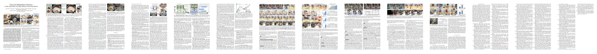
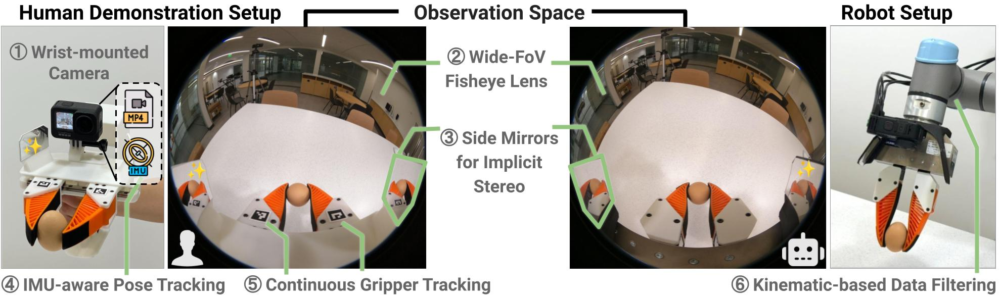

<h1 id="awesome-umi">Awesome-UMI</h1>

  <strong>A curated map of papers, datasets, policies, and taxonomy for the Universal Manipulation Interface ecosystem.</strong>

<!--  -->
<!--  -->

  
  
  
  
  

<a href="https://chang-xinhai.github.io/Awesome-UMI/"><strong>Explore the visual atlas →</strong></a> · Images, filters, details, and side-by-side comparison

## About

**Awesome-UMI**: A curated list for the ecosystem around **Universal Manipulation Interface (UMI)**.

This repository focuses on:
- **UMI Core**: foundational papers, official resources, and direct ecosystem-defining follow-ups
- **UMI Method**: strong adjacent methods for robot-free teaching, teleoperation, dexterous manipulation, multimodal sensing, and cross-embodiment transfer
- **UMI Dataset**: official UMI datasets and UMI-native dataset families
- **UMI Policy**: policies explicitly trained on UMI data, adapted through UMI systems, or evaluated on UMI benchmarks
- **UMI Taxonomy**: embodiments, modalities, pose tracking, data formats, deployment-facing notes, and survey-style resources

This list is intentionally **UMI-first**, not a generic robot-manipulation survey.

  
   
  Source: original UMI project page, <a href="https://umi-gripper.github.io/">umi-gripper.github.io</a>.

  
   
  Source: original UMI project page, <a href="https://umi-gripper.github.io/">umi-gripper.github.io</a>.

## Must Read

Start here if you want the shortest path through the UMI ecosystem.

| Goal | Start with |
| :-- | :-- |
| Understand UMI | [UMI paper](https://arxiv.org/abs/2402.10329), [project](https://umi-gripper.github.io/), [code](https://github.com/real-stanford/universal_manipulation_interface) |
| Find UMI datasets | [UMI Data Community Site](https://umi-data.github.io/) |
| Build on UMI hardware/data collection | [Universal Manipulation Interface Codebase](https://github.com/real-stanford/universal_manipulation_interface), [FastUMI](https://fastumi.com/), [LEGATO](https://ut-hcrl.github.io/LEGATO/), [UMI-FT](https://github.com/real-stanford/UMI-FT), [exUMI](https://silicx.github.io/exUMI/) |
| Explore dexterous UMI extensions | [SEED-UMI](https://arxiv.org/abs/2609.11753), [DexUMI](https://arxiv.org/abs/2505.21864), [RealDexUMI](https://arxiv.org/abs/2606.06033) |
| Add touch or force supervision | [$\mathcal{N}_0$-TacUMI](https://arxiv.org/abs/2608.29601), [UMI-FT](https://github.com/real-stanford/UMI-FT), [TacUMI](https://github.com/Tac-UMI/TacUMI), [exUMI](https://github.com/silicx/exUMI), [ViTaMIn](https://chuanyune.github.io/ViTaMIn_page/) |
| Train explicitly UMI-backed policies | [RDT2](https://rdt-robotics.github.io/rdt2/), [VISTA](https://tele-umi-vista.github.io/), [Hy-Embodied-0.5-VLA](https://arxiv.org/abs/2606.14409), [HiFi-UMI](https://arxiv.org/abs/2607.25895) |
| Compare modalities, tracking, and formats | [UMI Taxonomy](#umi-taxonomy), [UMI Data Community Site](https://umi-data.github.io/) |

## News

- [2026-04-19] Rebuilt the repository into a single-file `README.md` structure for Awesome-UMI.

## Contents

- [Awesome-UMI](#awesome-umi)
  - [About](#about)
  - [Must Read](#must-read)
  - [News](#news)
  - [UMI Core](#umi-core)
    - [Foundational Paper](#foundational-paper)
    - [Official Resources](#official-resources)
  - [UMI Method](#umi-method)
    - [Human Demonstration Interfaces](#human-demonstration-interfaces)
    - [Dexterous Hand / DexHand](#dexterous-hand--dexhand)
    - [Multimodal / Force / Tactile](#multimodal--force--tactile)
    - [In-the-Wild / Mobile / Whole-Body](#in-the-wild--mobile--whole-body)
    - [Closed-Loop Collection / Policy Feedback](#closed-loop-collection--policy-feedback)
    - [Community Hardware Builds](#community-hardware-builds)
    - [Commercial UMI Systems](#commercial-umi-systems)
  - [UMI Dataset](#umi-dataset)
    - [Official / Core Datasets](#official--core-datasets)
    - [UMI-native Dataset Families](#umi-native-dataset-families)
  - [UMI Policy](#umi-policy)
    - [Imitation Learning](#imitation-learning)
    - [VLA](#vla)
    - [World-Action / Video-Action Policies](#world-action--video-action-policies)
  - [UMI Taxonomy](#umi-taxonomy)
    - [Design Dimensions](#design-dimensions)
    - [Data Scaling / Collection Quality](#data-scaling--collection-quality)
    - [Benchmarks / Evaluation Dimensions](#benchmarks--evaluation-dimensions)
    - [Related Curated Indexes](#related-curated-indexes)
  - [Citation](#citation)
  - [Acknowledgement](#acknowledgement)

## UMI Core

Foundational UMI resources: the original paper, official project/code/data links, and direct ecosystem entry points.

### Foundational Paper

| Date | Keywords | Institute (first) | Paper | Publication | Others |
| :--: | :------: | :---------------: | :--- | :---------: | :----: |
| 2024-09-29 | UMI Redesign, Hardware-Independent, Off-the-Shelf Tracking, 10K+ Demos | Shanghai AI Lab | [FastUMI: A Scalable and Hardware-Independent Universal Manipulation Interface with Dataset](https://arxiv.org/abs/2409.19499) | CoRL 2025 | [project](https://fastumi.com/) / [data](https://huggingface.co/datasets/IPEC-COMMUNITY/FastUMI-Data) / [github](https://github.com/YdingTeam/FastUMI_Data) |
| 2024-02-15 | UMI, Robot-Free Teaching, Bimanual, Zero-Shot | Stanford | [Universal Manipulation Interface: In-The-Wild Robot Teaching Without In-The-Wild Robots](https://arxiv.org/abs/2402.10329) | RSS 2024 | [project](https://umi-gripper.github.io/) / [github](https://github.com/real-stanford/universal_manipulation_interface) / [data](https://umi-data.github.io/) |

### Official Resources

| Date | Keywords | Institute (first) | Paper | Publication | Others |
| :--: | :------: | :---------------: | :--- | :---------: | :----: |
| 2024-02-15 | Official Dataset Index, MP4/VIO/Zarr Tiers, 59.94 Hz Schema | Stanford | [UMI Data Community Site and Dataset Format](https://umi-data.github.io/) | Website | [format specification](https://umi-data.github.io/) |
| 2024-02-15 | Official Code, Training Stack | Stanford | [Universal Manipulation Interface Codebase](https://github.com/real-stanford/universal_manipulation_interface) | GitHub | [github](https://github.com/real-stanford/universal_manipulation_interface) |
| 2024-02-15 | Official Project Page | Stanford | [UMI Project Page](https://umi-gripper.github.io/) | Website | [project](https://umi-gripper.github.io/) |

## UMI Method

Methods for UMI-style robot-free teaching, teleoperation, cross-embodiment transfer, dexterous manipulation, and multimodal deployment.

### Human Demonstration Interfaces

| Date | Keywords | Institute (first) | Paper | Publication | Others |
| :--: | :------: | :---------------: | :--- | :---------: | :----: |
| 2026-10-20 | Head-Cam UMI, Electronics-Free Glove, Fiducial Tracking, Shared Observation/Labels | University of Hawaii at Manoa | [A Head Camera Is (Almost) All You Need: An Electronics-Free UMI Glove Labelled and Observed by One Moving Camera](https://arxiv.org/abs/2610.27622) | arXiv | [github](https://github.com/YosubShin/head-cam-umi) / [hardware base](https://github.com/YosubShin/yam-umi) |
| 2026-09-19 | KIWI, Dual-Lens 360 Cameras, Shared Metric Map, Modular Bimanual Capture | Autel US | [Kinematic Interface for the Wild: Modular Bimanual Loco-Manipulation Capture from 360° Cameras Alone](https://arxiv.org/abs/2609.22809) | arXiv | [project](https://lingfeng.moe/KIWI/) / [code](https://github.com/TToTMooN/KIWI_software) / [data (sample)](https://github.com/TToTMooN/KIWI_software#5-try-it-without-hardware) / [hardware](https://github.com/TToTMooN/KIWI_hardware) |
| 2026-07-28 | High-Fidelity UMI, Stereo-Inertial SLAM, 2,000 Hours | Simple AI | [HiFi-UMI: Learning Deployable Manipulation Policies from High-Fidelity UMI Data Alone](https://arxiv.org/abs/2607.25895) | arXiv | [project](https://cloud.simpleai.tech/simple-world-lab/hifi-umi/) / [dataset](https://huggingface.co/datasets/simple-world-lab/HiFi-UMI-2K) |
| 2026-07-07 | UMI, Vive Tracking, Open-Source Collection | 穹明智能 | [UMI ver.2](https://github.com/qiongming-intelligence/UMI) | Open-source system | [docs](https://www.cnblogs.com/ydzn/p/21220815) |
| 2026-06-29 | Behavior Prompting, iPhUMI, One-Shot Demo | Stanford | [What Enables In-Context Behavior Prompting for Manipulation?](https://arxiv.org/abs/2606.30457) | arXiv | [project](https://behavior-prompting.github.io/) / [github](https://github.com/real-stanford/behavior_prompting) / [iPhUMI](https://github.com/real-stanford/iPhUMI) / [model (laundry)](https://huggingface.co/austinpatel/bp_iphumi_bimanual_laundry_folding) / [model (drawing)](https://huggingface.co/austinpatel/bp_iphumi_drawanything_real) |
| 2026-06-08 | Finger-Aligned, Bimanual, Large-Scale | AIRoA | [YUBI: Yielding Universal Bidigital Interface for Bimanual Dexterous Manipulation at Scale](https://arxiv.org/abs/2606.10244) | CoRL 2026 | [project](https://yubi.airoa.io/) / [hardware](https://github.com/toyota/yubi-hw) / [software](https://github.com/airoa-org/yubi-sw) |
| 2026-05-12 | UMI-Derived, Handheld, Matched Robot Gripper, Force Sensing | RAI Institute | [Getting a Grip on Robotic Data Collection](https://rai-inst.com/resources/blog/handheld-robotic-data-collection/) | Website | — |
| 2026-04-15 | 3D Perception, LiDAR, UMI Extension | HKU | [UMI-3D: Extending Universal Manipulation Interface from Vision-Limited to 3D Spatial Perception](https://arxiv.org/abs/2604.14089) | arXiv | [project](https://umi-3d.github.io/) / [dataset](https://github.com/Physical-Intelligence-Laboratory/UMI-3D-Dataset) / [policy](https://github.com/Physical-Intelligence-Laboratory/UMI-3D-Policy) / [hardware](https://github.com/Physical-Intelligence-Laboratory/UMI-3D-Hardware) / [code (SLAM / processing; GPL-2.0)](https://github.com/hku-mars/UMI-3D) |
| 2026-03-17 | UMI Gripper, Demonstration Quality, Ergonomics | UMass Amherst | [Influence of Gripper Design on Human Demonstration Quality for Robot Learning](https://arxiv.org/abs/2603.17189) | ICRA 2026 | [paper](https://arxiv.org/abs/2603.17189) |
| 2025-11-12 | Egocentric Point Cloud, Cross-Embodiment | Tsinghua SIGS | [UMIGen: A Unified Framework for Egocentric Point Cloud Generation and Cross-Embodiment Robotic Imitation Learning](https://arxiv.org/abs/2511.09302) | arXiv | [paper](https://arxiv.org/abs/2511.09302) |
| 2025-10-02 | Active Perception, VR, Robot-Free | Shanghai University | [ActiveUMI: Robotic Manipulation with Active Perception from Robot-Free Human Demonstrations](https://arxiv.org/abs/2510.01607) | arXiv | [project](https://activeumi.github.io/) |
| 2025-09-23 | Multi-View UMI, Wrist+Third-Person, Cross-Embodiment | NYU Abu Dhabi | [MV-UMI: A Scalable Multi-View Interface for Cross-Embodiment Learning](https://arxiv.org/abs/2509.18757) | arXiv | [project](https://mv-umi.github.io/) |
| 2025-06-11 | UMI Hardware, Continuous Demonstration Segmentation, IMU+Marker EKF, Agriculture | Eurecat | [Advances on Affordable Hardware Platforms for Human Demonstration Acquisition in Agricultural Applications](https://arxiv.org/abs/2506.09494) | ERF 2025 | [doi](https://doi.org/10.1007/978-3-031-89471-8_14) |
| 2024-11-06 | Handheld Grasping Tool, Cross-Embodiment, Motion-Invariant | UT Austin | [LEGATO: Cross-Embodiment Imitation Using a Grasping Tool](https://arxiv.org/abs/2411.03682) | RA-L 2025 | [project](https://ut-hcrl.github.io/LEGATO/) / [github](https://github.com/UT-HCRL/LEGATO) |
| 2024-02-15 | Handheld Interface, Bimanual, Portable | Stanford | [Universal Manipulation Interface: In-The-Wild Robot Teaching Without In-The-Wild Robots](https://arxiv.org/abs/2402.10329) | RSS 2024 | [project](https://umi-gripper.github.io/) / [github](https://github.com/real-stanford/universal_manipulation_interface) |

### Dexterous Hand / DexHand

| Date | Keywords | Institute (first) | Paper | Publication | Others |
| :--: | :------: | :---------------: | :--- | :---------: | :----: |
| 2026-09-10 | Shared Human/Robot Exoskeleton, 20-DoF Encoders, Paired Contact Calibration | Peking University | [SEED-UMI: Sharing the Exoskeleton between human and robot for onE-to-one Dexterous demonstration](https://arxiv.org/abs/2609.11753) | CoRL 2026 | [project](https://tengbo-yu.github.io/SEED-UMI/) / [github](https://github.com/Tengbo-Yu/SEED-UMI) |
| 2026-06-04 | Wearable DexHand, Tactile, In-Hand Vision | Peking University | [RealDexUMI: A Wearable Universal Manipulation Interface for Dexterous Robot Learning](https://arxiv.org/abs/2606.06033) | arXiv | [project](https://research.beingbeyond.com/realdexumi) / [product](https://beingbeyond.com/solutions/U1) |
| 2026-04-16 | DexUMI-Based Policy, Forearm-Mounted Hand, Motor Torque, Force Feedback | Sogang University | [DEX-Mouse: A Low-cost Portable and Universal Interface with Force Feedback for Data Collection of Dexterous Robotic Hands](https://arxiv.org/abs/2604.15013) | arXiv | [project](https://dex-mouse.github.io/) |
| 2026-03-18 | UMI-Adjacent, Robot-Free, Five-Finger Tactile, Mirrored Sensing | Huazhong University of Science and Technology | [DexViTac: Collecting Human Visuo-Tactile-Kinematic Demonstrations for Contact-Rich Dexterous Manipulation](https://arxiv.org/abs/2603.17851) | arXiv | [project](https://xitong-c.github.io/DexViTac/) / [code (forthcoming)](https://github.com/xitong-c/DexViTac_Code) / [data (forthcoming)](https://huggingface.co/datasets/xitong-c/DexViTac_Dataset) |
| 2026-03-18 | DexUMI Alternative, Passive Hand, Hardware Alignment, Cross-Operator | UCLA | [DexEXO: A Wearability-First Dexterous Exoskeleton for Operator-Agnostic Demonstration and Learning](https://arxiv.org/abs/2603.17323) | IROS 2026 | [project](https://dexexo-research.github.io/) / [CAD (Onshape; license unverified)](https://cad.onshape.com/documents/9d0951a3277fbeb5ba418f99/w/cf7e5ff15e0c9dc9f2eef6ce/e/bf3c476ef275f3aa8b545a9a) |
| 2025-09-04 | UMI-Style, Passive Dexterous Hand, Whole-Hand Touch, Robot-Free | MIT Improbable AI Lab | [DEXOP: A Device for Robotic Transfer of Dexterous Human Manipulation](https://arxiv.org/abs/2509.04441) | arXiv | [project](https://dex-op.github.io/) |
| 2025-05-28 | DexHand, Wearable, Cross-Hand | Stanford | [DexUMI: Using Human Hand as the Universal Manipulation Interface for Dexterous Manipulation](https://arxiv.org/abs/2505.21864) | CoRL 2025 | [project](https://dex-umi.github.io/) / [github](https://github.com/real-stanford/DexUMI) / [data](https://umi-data.github.io/) |

### Multimodal / Force / Tactile

| Date | Keywords | Institute (first) | Paper | Publication | Others |
| :--: | :------: | :---------------: | :--- | :---------: | :----: |
| 2026-10-22 | UMI/YUBI Tactile Skins, Normal+Shear, Flex PCB, CAD/SDK/Simulation, Sensor Transfer | Johns Hopkins University | [OpenTac: An Open Ecosystem for Customizable, Scalable, and Transferable 3D Tactile Sensing](https://arxiv.org/abs/2610.31661) | arXiv | [project](https://opentac.github.io/) / [github](https://github.com/opentac/opentac) |
| 2026-10-14 | UMI-Style, Mechanical Force Feedback, Robot-Free, Bimanual | HKUST | [FOMI: A Force-Feedback Manipulation Interface for Teaching Contact-Rich Manipulation](https://arxiv.org/abs/2610.19839) | arXiv | [project](https://robbyant-research.github.io/FOMI/) |
| 2026-09-24 | Wireless Handheld, Vision+Touch+Audio, Shared Sensing Finger | Northwestern University | [PolyUMI: Accessible Visual-Tactile-Audio Data Collection for Object Inference and Manipulation](https://arxiv.org/abs/2609.29760) | arXiv | [project](https://polyumi-vista.github.io/) / [github](https://github.com/PolyUMI-VisTA/PolyUMI-system) |
| 2026-09-14 | UMI-Trained Slip Detection, TacV5, Pressure+Vibration, Cross-Hand Transfer | Analog Devices | [SlipSense: Multimodal Tactile Learning for Low-Latency and Generalized Slip Detection](https://arxiv.org/abs/2609.15910) | CoRL 2026 | — |
| 2026-08-30 | TacUMI, RGB+Dual Touch, Infrared 6-DoF, 30K Hours, Cross-Sensor Force | NeoteAI | [$\mathcal{N}_0$-Foundation: Towards the Age of Tactile Intelligence](https://arxiv.org/abs/2608.29601) | Technical Report | [project](https://research.neoteai.com/n0-foundation/) / [github](https://github.com/neoteai/N0-Foundation) / [data](https://huggingface.co/datasets/NeoteAIEmbodied/OpenNeoData) / [model](https://huggingface.co/NeoteAI/NeoForce) |
| 2026-06-11 | Whole-Body Tactile, Force-Supervised, Humanoid | Georgia Tech | [WT-UMI: Tactile-based Whole-Body Manipulation via Force-Supervised Contact-Aware Planning](https://arxiv.org/abs/2606.13232) | arXiv | [project](https://wt-umi.github.io/WTUMI/) / [hardware](https://github.com/wt-umi/WTUMI-Hardware) |
| 2026-04-12 | Multimodal, Tactile, Force/Wrench | BAAI | [OmniUMI: Towards Physically Grounded Robot Learning via Human-Aligned Multimodal Interaction](https://arxiv.org/abs/2604.10647) | arXiv | [project](https://baai-aether.github.io/OmniUMI/) |
| 2026-01-21 | Tactile, Force/Torque, Contact-Rich | TU Munich | [TacUMI: A Multi-Modal Universal Manipulation Interface for Contact-Rich Tasks](https://arxiv.org/abs/2601.14550) | ICRA 2026 | [github](https://github.com/Tac-UMI/TacUMI) |
| 2026-01-15 | Force, Compliance, Contact-Rich | Stanford | [In-the-Wild Compliant Manipulation with UMI-FT](https://arxiv.org/abs/2601.09988) | ICRA 2026 | [github](https://github.com/real-stanford/UMI-FT) |
| 2025-12-10 | TacThru-UMI, See-Through-Skin, Simultaneous Vision+Touch, Vive Tracking | Peking University | [Simultaneous Tactile-Visual Perception for Learning Multimodal Robot Manipulation](https://arxiv.org/abs/2512.09851) | RA-L 2026 | [project](https://tacthru.yuyang.li/) / [github](https://github.com/YuyangLee/TacThru) / [dataset](https://huggingface.co/datasets/aidenli/tacthru_umi_tasks) |
| 2025-12-04 | Force-Grounded, Cross-View, UMI Gripper, Articulated Objects | ETH Zurich | [Hoi! - A Multimodal Dataset for Force-Grounded, Cross-View Articulated Manipulation](https://arxiv.org/abs/2512.04884) | CVPR 2026 | [project](https://hoi-dataset.ethz.ch/index.html) / [github](https://github.com/timengelbracht/hoi-dataset-tools) |
| 2025-11-08 | Vision+Tactile, Fine Manipulation | Tsinghua | [ViTaMIn-B: A Reliable and Efficient Visuo-Tactile Bimanual Manipulation Interface](https://arxiv.org/abs/2511.05858) | arXiv | [project](https://chuanyune.github.io/ViTaMIn-B_page/) / [github](https://github.com/chuanyune/ViTaMIn-B_code) / [dataset](https://huggingface.co/datasets/chuanyune/ViTaMIn-B_data_and_ckpt) |
| 2025-09-18 | Tactile, Robot Teaching, Single-Arm | SJTU | [exUMI: Extensible Robot Teaching System with Action-aware Task-agnostic Tactile Representation](https://silicx.github.io/exUMI/) | CoRL 2025 | [project](https://silicx.github.io/exUMI/) / [github](https://github.com/silicx/exUMI) / [paper](https://arxiv.org/abs/2509.14688) |
| 2025-07-20 | UMI Gripper Adaptation, Flexible Touch, Cross-Modal Pretraining | Columbia University | [Touch in the Wild: Learning Fine-Grained Manipulation with a Portable Visuo-Tactile Gripper](https://arxiv.org/abs/2507.15062) | NeurIPS 2025 | [project](https://binghao-huang.github.io/touch_in_the_wild/) / [github](https://github.com/YolandaXinyueZhu/touch_in_the_wild) / [dataset](https://huggingface.co/datasets/binghaohuang-robot/touch_in_the_wild-dataset) |
| 2025-06-02 | Robot-Free, Visuo-Tactile, Wearable | Shanghai Innovation Institute | [FreeTacMan: Robot-free Visuo-Tactile Data Collection System for Contact-rich Manipulation](https://arxiv.org/abs/2506.01941) | ICRA 2026 | [project](https://opendrivelab.com/FreeTacMan) / [github](https://github.com/OpenDriveLab/FreeTacMan) |
| 2025-04-08 | Robot-Free, Visuo-Tactile, Contact-Rich | Tsinghua | [ViTaMIn: Learning Contact-Rich Tasks Through Robot-Free Visuo-Tactile Manipulation Interface](https://arxiv.org/abs/2504.06156) | arXiv | [project](https://chuanyune.github.io/ViTaMIn_page/) / [dataset](https://huggingface.co/datasets/chuanyune/ViTaMIn_dataset) |
| 2024-10-10 | UMI-Inspired, Robot-Free, 6-Axis Force/Torque, RGB-D | Shanghai Jiao Tong University | [ForceMimic: Force-Centric Imitation Learning with Force-Motion Capture System for Contact-Rich Manipulation](https://arxiv.org/abs/2410.07554) | ICRA 2025 | [project](https://forcemimic.github.io/) / [collection code](https://github.com/ForceMimic/forcecapture) / [policy code](https://github.com/ForceMimic/hybridil) |
| 2024-06-27 | UMI Extension, Contact Audio, Audio-Visual Policy | Stanford | [ManiWAV: Learning Robot Manipulation from In-the-Wild Audio-Visual Data](https://arxiv.org/abs/2406.19464) | CoRL 2024 | [project](https://maniwav.github.io/) / [github](https://github.com/real-stanford/maniwav) / [data](https://real.stanford.edu/maniwav/) |

### In-the-Wild / Mobile / Whole-Body

| Date | Keywords | Institute (first) | Paper | Publication | Others |
| :--: | :------: | :---------------: | :--- | :---------: | :----: |
| 2026-10-08 | UMI Grippers, Wearable Contact Patches, Humanoid Whole-Body Dexterity | Stanford | [PanTact: Teaching Whole-Body Dexterity with a Wearable Contact Interface](https://arxiv.org/abs/2610.12558) | arXiv | [project](https://pantact.github.io/) |
| 2026-10-06 | VOMMI, UMI-Style Gripper, RGB Body/Hand VO, Mobile VLA | Zhejiang University | [VOMMI: Collecting and Leveraging Portable Demonstrations for Mobile Manipulation](https://arxiv.org/abs/2610.08220) | arXiv | — |
| 2026-09-19 | Native UMI Transfer, Humanoid, Whole-Body Motion Generation | Zhejiang University | [Whole-Body UMI: Transferring UMI Manipulation Skills to Humanoid Whole-Body Manipulation via Real-Time Motion Generation](https://arxiv.org/abs/2609.22829) | arXiv | — |
| 2026-06-17 | UMI Extension, Head-Hand Tracking, Active Egocentric Vision, Humanoid | Shanghai Jiao Tong University | [HALOMI: Learning Humanoid Loco-Manipulation with Active Perception from Human Demonstrations](https://arxiv.org/abs/2606.18772) | arXiv | [project](https://halomi-humanoid.github.io/) |
| 2026-05-20 | Mobile Manipulation, Cross-View, Robot-Free | Zhejiang University | [Mobile UMI: Cross-View Diffusion Policy with Decoupled Kinematics for Mobile Manipulation](https://arxiv.org/abs/2605.20894) | arXiv | [paper](https://arxiv.org/abs/2605.20894) |
| 2026-05-05 | VR-UMI, Robot-Free, Humanoid Whole-Body | BAAI | [BifrostUMI: Bridging Robot-Free Demonstrations and Humanoid Whole-Body Manipulation](https://arxiv.org/abs/2605.03452) | arXiv | [project](https://baai-aether.github.io/BifrostUMI/) |
| 2026-03-27 | Underwater, Robot-Free, Domain Transfer | Stanford | [UMI-Underwater: Learning Underwater Manipulation without Underwater Teleoperation](https://arxiv.org/abs/2603.27012) | arXiv | [project](https://umi-under-water.github.io/) / [github](https://github.com/umi-under-water/UMI_underwater) |
| 2026-03-03 | UMI Grippers, Egocentric Sensing, Hand-Eye Policy | Stanford | [HoMMI: Learning Whole-Body Mobile Manipulation from Human Demonstrations](https://arxiv.org/abs/2603.03243) | RSS 2026 | [project](https://hommi-robot.github.io/) / [github](https://github.com/xxm19/hommi) |
| 2026-02-06 | Humanoid, Whole-Body, Bimanual | Tsinghua | [HuMI](https://humanoid-manipulation-interface.github.io/) | arXiv / Dataset | [project](https://humanoid-manipulation-interface.github.io/) / [paper](https://arxiv.org/abs/2602.06643) |
| 2025-10-31 | Egocentric, Active Vision, Whole-Body | UC Berkeley | [EgoMI: Learning Active Vision and Whole-Body Manipulation from Egocentric Human Demonstrations](https://arxiv.org/abs/2511.00153) | arXiv | [project](https://egocentric-manipulation-interface.github.io/) |
| 2025-10-02 | Aerial Manipulation, Embodiment-Aware Guidance | CMU | [UMI-on-Air: Embodiment-Aware Guidance for Embodiment-Agnostic Visuomotor Policies](https://arxiv.org/abs/2510.02614) | ICRA 2026 | [project](https://umi-on-air.github.io/) / [github](https://github.com/LeCAR-Lab/UMI-on-Air) |
| 2024-07-14 | Mobile Manipulation, Whole-Body, Legged | Stanford | [UMI on Legs: Making Manipulation Policies Mobile with Manipulation-Centric Whole-body Controllers](https://arxiv.org/abs/2407.10353) | CoRL 2024 | [project](https://umi-on-legs.github.io/) / [github](https://github.com/real-stanford/umi-on-legs) |

### Closed-Loop Collection / Policy Feedback

Interfaces that use feasibility checks, coverage feedback, policy predictions, or corrective interaction to guide data acquisition. EgoGuide currently provides a project page, with code and its assembly guide marked as forthcoming. TAMEn is maintained as BiTacMan: BiTacAR collection tools and [724 four-view trajectories](https://huggingface.co/datasets/OpenDriveLab-org/BiTacMan) are public; CAD and training remain on the [release roadmap](https://github.com/OpenDriveLab/BiTacMan#-todo-list).

| Date | Keywords | Institute (first) | Paper | Publication | Others |
| :--: | :------: | :---------------: | :--- | :---------: | :----: |
| 2026-06-12 | EgoGuide-UMI, AR Coverage Guidance, Wrist+Head Views, Gated Residual Policy | SJTU | [EgoGuide: Egocentric Guidance for Efficient Robot-Free Demonstration Collection and Learning](https://arxiv.org/abs/2606.14665) | arXiv | [project](https://silicx.github.io/EgoGuide/) |
| 2026-04-14 | XRZero-G0, VR Tracking, Dual Grippers, Closed-Loop Quality Control | X Square Robot | [XRZero-G0: Pushing the Frontier of Dexterous Robotic Manipulation with Interfaces, Quality and Ratios](https://arxiv.org/abs/2604.13001) | Technical Report | [github](https://github.com/X-Square-Robot/XRZero-G0) / [product](https://x2robot.com/en/news/6a46341cc7feadddbc603a33) |
| 2026-04-08 | UMI-Style, Dual-Mode Tracking, Tactile Recovery | Fudan University | [TAMEn: Tactile-Aware Manipulation Engine for Closed-Loop Data Collection in Contact-Rich Tasks](https://arxiv.org/abs/2604.07335) | arXiv | [github](https://github.com/OpenDriveLab/BiTacMan) |
| 2026-03-05 | Handheld UMI Alternative, AR Foresight, Online Finetuning | SJTU | [RoboPocket: Improve Robot Policies Instantly with Your Phone](https://arxiv.org/abs/2603.05504) | CoRL 2026 | [project](https://robo-pocket.github.io/) / [manufacturer](https://www.noematrix.ai/news/Noematrix-WAIC2026) |

### Community Hardware Builds

`—` means no original release date is stated by the canonical source.

| Date | Keywords | Institute (first) | Paper | Publication | Others |
| :--: | :------: | :---------------: | :--- | :---------: | :----: |
| — | Robot-Free, Hand-Worn, Open Hardware, LeRobot | murobotics-ai | [HandUMI](https://github.com/murobotics-ai/handumi-hw) | GitHub | [software](https://github.com/murobotics-ai/handumi-sw) / [assembly guide](https://github.com/murobotics-ai/handumi-hw/blob/main/hardware/HandUMI_Assembly_Guide.pdf) / [robot-specific tips](https://github.com/murobotics-ai/handumi-hw/tree/main/hardware/STEP/gripper_tips) / [calibration board](https://github.com/murobotics-ai/handumi-hw/blob/main/hardware/calibration/charuco_5x7_30mm_A4.pdf) |
| — | Robot-Free, Handheld RGB-D, Open Hardware, LeRobot | Pollen Robotics | [Grabette](https://github.com/pollen-robotics/grabette) | GitHub | [device software](https://github.com/pollen-robotics/grabette) / [SLAM / LeRobot](https://github.com/pollen-robotics/grabette-slam) / [policy](https://github.com/pollen-robotics/grabette-policy) |

### Commercial UMI Systems

Official commercial interfaces and product families. `—` means no publication or product-release date is stated in the canonical source; copyright years are not used as launch dates.

| Date | Keywords | Institute (first) | Paper | Publication | Others |
| :--: | :------: | :---------------: | :--- | :---------: | :----: |
| 2026-07-29 | Commercial Solution, UMI, Tactile, VR Tracking | Huaweike Intelligent Tech / 华威科 | [HIT UMI Tactile Collection](https://www.hbwhhit.com/news/waic-2026-direct-hit-unveils-next-gen-tactile-85599619.html) | Solution | — |
| 2026-07-02 | Commercial, UMI-VIO, Bimanual, Tactile, Audio | X Square Robot | [QUANXTA Zero-G1](https://x2robot.com/en/news/6a46341cc7feadddbc603a33) | Product | — |
| 2026-02-05 | Commercial, Modular UMI, RGB, Audio, IMU | IO-AI Tech / 艾欧智能 | [SenseXperience UMI](https://io-ai.tech/en/sensexperience/) | Product | [docs](https://io-ai.tech/sensexperience/en/docs/) / [announcement](https://io-ai.tech/zh/news/sensexperience-real-world-data-collection-solution/) |
| 2026-02 | Commercial, UMI-Compatible, Wearable | Lumos Robotics | [FastUMI Go](https://www.lumosbot.tech/products/fastumi-go/) | Product | — |
| 2025-11 | Commercial, UMI-Style Handheld, Optional Tactile | Lumos Robotics | [FastUMI Pro](https://www.lumosbot.tech/products/fastumi-pro/) | Product | — |
| — | Commercial, UMI-Style Handheld, Tactile | Xense Robotics | [XTac-UMI G1](https://xenserobotics.com/product/392226/detail/22) | Product | [docs](https://docs.xenserobotics.com/en/docs/latest/xtac/) / [sdk](https://github.com/XenseRobotics-AI/TacCap-Gripper) |
| — | Commercial, UMI-Style Handheld, Tactile | GenRobot | [DAS Gripper](https://www.genrobot.ai/products/das) | Product | [docs](https://docs.genrobot.ai/products/das-gripper) / [sdk](https://github.com/genrobot-ai/gen_controller_sdk_release) |
| — | Commercial, UMI-Style Handheld, Tactile | GenRobot | [DAS Fingers](https://www.genrobot.ai/products/finger) | Product | [docs](https://docs.genrobot.ai/products/das-finger) / [sdk](https://github.com/genrobot-ai/gen_finger_con_python_sdk_release) |
| — | Commercial, Wearable Hand, Tactile | GenRobot | [DAS Dex](https://www.genrobot.ai/products/dex) | Product | — |
| — | Commercial, UMI-Style Handheld | AgileX Robotics | [Pika Sense](https://global.agilex.ai/products/pika) | Product | [docs](https://github.com/agilexrobotics/pika_sdk) |
| — | Commercial, UMI-Style Handheld | Trossen Robotics | [TRumi](https://www.trossenrobotics.com/trumi) | Product | [docs](https://docs.trossenrobotics.com/trumi/index.html) |
| — | Commercial, UMI-Style Handheld | Almond | [Mantis UMI](https://www.almond.bot/mantis-umi) | Product | [docs](https://docs.almond.bot/mantis/hardware) / [sdk](https://github.com/almond-bot/axol) |
| — | Commercial, UMI-Style Handheld | Orbbec | [Orbbec UMI Finger / Gripper](https://www.orbbec.com/robot-free-data-collection/) | Product | — |
| — | Commercial, UMI-Compatible, Handheld | Maniformer | [MEgo Gripper](https://www.maniformer.net/mego) | Product | [docs](https://www.maniformer.net/support/mego-gripper-manual-cn) |
| — | Commercial, UMI-Compatible, Handheld | LivSyn Robotics | [LivUMI](https://www.livsynrobotics.com/products/umi) | Product | — |
| — | Commercial, UMI-Compatible, Wearable | Linkerbot | [UMI-Dex](https://github.com/linker-bot/umi-dex) | Product | [docs](https://github.com/linker-bot/umi-dex/tree/main/docs) |
| — | Commercial, UMI-Compatible, Wearable | Chestnut Robotics | [Aero UMI](https://chestnut.bot/aero-umi.html) | Product | — |
| — | Commercial, UMI-Compatible, Wearable | Maniformer | [MEgo View](https://www.maniformer.net/support/mego-view-cn-8eynke) | Product | — |

## UMI Dataset

Datasets collected by a named UMI system, released as part of a direct UMI extension, or explicitly packaged for UMI-backed training and evaluation.

### Official / Core Datasets

| Date | Keywords | Institute (first) | Paper | Publication | Others |
| :--: | :------: | :---------------: | :--- | :---------: | :----: |
| 2024-02-15 | UMI, Bimanual, Zarr, MP4 | Stanford | [UMI Dataset Family](https://umi-data.github.io/) | Dataset | [project](https://umi-gripper.github.io/) / [data](https://umi-data.github.io/) |

### UMI-native Dataset Families

| Date | Keywords | Institute (first) | Paper | Publication | Others |
| :--: | :------: | :---------------: | :--- | :---------: | :----: |
| 2026-10-14 | TacClaw, UMI-Style VTLA, 10K+ Hours Claimed, Public Subset | Daimon Robotics | [TacClaw-Infinity: A Large-Scale Vision-Tactile-Language-Action Dataset for Dexterous Manipulation](https://arxiv.org/abs/2610.20320) | arXiv / Dataset | [project](https://daimon-robotics.github.io/tacclaw-infinity-page/) / [github](https://github.com/daimon-robotics/TacClaw-Infinity) / [dataset](https://huggingface.co/datasets/daimonrobotics/Daimon-Infinity) |
| 2026-10-03 | GiT, 1,800 UMI Demos Reported, 18 Real Tasks, Public Simulation Subset | South China University of Technology | [Grounded in Time: A Multi-Source Dataset and Benchmark for Temporal Grounding in Robotic Manipulation](https://arxiv.org/abs/2610.04255) | arXiv / Dataset / Benchmark | [project](https://kk-stephen.github.io/grounded-in-time/) / [github (benchmark; license unspecified)](https://github.com/xgq2005/GiTBench) / [data (simulation subset)](https://huggingface.co/datasets/XGQ12345/GiTBench_sim_train_lerobotv3) |
| 2026-08-30 | OpenNeoData, 5,000+ Released Hours, Mixed Robot+UMI, Gated HF, 257 Tasks | NeoteAI | [$\mathcal{N}_0$-Foundation / OpenNeoData](https://arxiv.org/abs/2608.29601) | Technical Report / Dataset | [project](https://research.neoteai.com/n0-foundation/) / [dataset](https://huggingface.co/datasets/NeoteAIEmbodied/OpenNeoData) / [model](https://huggingface.co/NeoteAI/NeoForce) |
| 2026-07-28 | 2,000 Released Hours, 6 Views, LeRobot/Parquet/MP4, CC BY 4.0 | Simple AI | [HiFi-UMI-2K](https://huggingface.co/datasets/simple-world-lab/HiFi-UMI-2K) | Dataset / arXiv | [paper](https://arxiv.org/abs/2607.25895) / [project](https://cloud.simpleai.tech/simple-world-lab/hifi-umi/) |
| 2026-06-29 | iPhUMI, Bimanual, iPhone, One-Shot Prompts | Stanford | [What Enables In-Context Behavior Prompting for Manipulation?](https://arxiv.org/abs/2606.30457) | Dataset / arXiv | [project](https://behavior-prompting.github.io/) / [github](https://github.com/real-stanford/iPhUMI) / [laundry](https://huggingface.co/datasets/austinpatel/iphumi_bimanual_laundry_folding) / [drawing](https://huggingface.co/datasets/austinpatel/iphumi_drawinganything_real) |
| 2026-06-12 | 2,163 Released Hours, 250,304 Episodes, 70+ Tasks, Lance | Tencent Robotics X | [Hy-Embodied-0.5-VLA-Data](https://huggingface.co/datasets/tencent/Hy-Embodied-0.5-VLA-Data) | Dataset / VLA | [paper](https://arxiv.org/abs/2606.14409) / [github](https://github.com/Tencent-Hunyuan/Hy-Embodied-0.5-VLA) / [model](https://huggingface.co/tencent/Hy-Embodied-0.5-VLA-UMI) |
| 2026-06-09 | 20K Sessions, 10 Tasks, Single/Bimanual, TAR, CC BY 4.0 | Soochow University | [UMI-Bench 1.0](https://umibenchmark.github.io/) | Dataset / Benchmark | [paper](https://arxiv.org/abs/2606.10382) / [dataset](https://huggingface.co/datasets/UMIbenchmark/UMI-Benchmark-v1) / [models](https://huggingface.co/UMIbenchmark/UMI-Benchmark-v1-checkpoints) |
| 2026-06-08 | Bimanual, 8,434 Hours Claimed, 1.20M Episodes, 119 Tasks, LeRobot 30 Hz, Full Release Pending | AIRoA | [YUBI](https://yubi.airoa.io/) | Dataset (release pending) / CoRL 2026 | [paper](https://arxiv.org/abs/2606.10244) / [project](https://yubi.airoa.io/) / [software](https://github.com/airoa-org/yubi-sw) |
| 2026-06-03 | 5K Validated Trajectories, 30 Tasks, 8M VQA Samples | TeleAI | [VISTA](https://tele-umi-vista.github.io/) | Dataset / VLA | [paper](https://arxiv.org/abs/2606.04708) / [github](https://github.com/TeleHuman/umi-vista) / [dataset](https://huggingface.co/collections/TeleEmbodied/vista) |
| 2026-04-15 | 4,609 Indexed Demos, 3 Tasks, LiDAR-Aided Capture, Zarr/ROS bag | HKU | [UMI-3D](https://github.com/Physical-Intelligence-Laboratory/UMI-3D-Dataset) | Dataset | [paper](https://arxiv.org/abs/2604.14089) / [project](https://umi-3d.github.io/) / [dataset](https://github.com/Physical-Intelligence-Laboratory/UMI-3D-Dataset) / [code (SLAM / processing; GPL-2.0)](https://github.com/hku-mars/UMI-3D) |
| 2026-04-14 | 3,697 Released Episodes, 20 Task Folders, Bimanual, LeRobot v3.0, 30 Hz | X Square Robot | [XRZero-G0: Pushing the Frontier of Dexterous Robotic Manipulation with Interfaces, Quality and Ratios](https://arxiv.org/abs/2604.13001) | Technical Report / Dataset | [github](https://github.com/X-Square-Robot/XRZero-G0) / [dataset](https://huggingface.co/datasets/x-square-robot/XRZero-G0-3K) / [product](https://x2robot.com/en/news/6a46341cc7feadddbc603a33) |
| 2026-04-08 | 724 Indexed Trajectories, 4 Tasks, Visuo-Tactile, CSV/MP4, CC BY-NC-SA 4.0 | Fudan University | [TAMEn: Tactile-Aware Manipulation Engine for Closed-Loop Data Collection in Contact-Rich Tasks](https://arxiv.org/abs/2604.07335) | Dataset / arXiv | [project](https://opendrivelab.com/BiTacMan) / [github](https://github.com/OpenDriveLab/BiTacMan) / [dataset](https://huggingface.co/datasets/OpenDriveLab-org/BiTacMan) |
| 2026-02-06 | 827 Indexed Demos, 5 Tasks, Whole-Body, Zarr/LeRobot/Raw | Tsinghua | [HuMI](https://humanoid-manipulation-interface.github.io/) | Dataset | [project](https://humanoid-manipulation-interface.github.io/) / [paper](https://arxiv.org/abs/2602.06643) / [datasets](https://huggingface.co/collections/Richard-Nai/humi) |
| 2025-12-31 | Gated MCAP, 13K+ Hours Claimed, Bimanual, Version-Specific Clip/Demo Counts | GenRobot | [GenRobot 10Kh-RealOmin OpenData](https://huggingface.co/datasets/genrobot2025/10Kh-RealOmin-OpenData) | Dataset | [page](https://www.genrobot.ai/) / [index](https://umi-data.github.io/) |
| 2025-12-10 | TacThru-UMI, 5 Public Task Archives, Vision+Touch, Zarr, MIT | Peking University | [Simultaneous Tactile-Visual Perception for Learning Multimodal Robot Manipulation](https://arxiv.org/abs/2512.09851) | Dataset / RA-L 2026 | [project](https://tacthru.yuyang.li/) / [github](https://github.com/YuyangLee/TacThru) / [dataset](https://huggingface.co/datasets/aidenli/tacthru_umi_tasks) |
| 2025-11-08 | 844 Indexed Demos, 4 Bimanual Tasks, Vision+Tactile, Zarr | Tsinghua | [ViTaMIn-B](https://chuanyune.github.io/ViTaMIn-B_page/) | Dataset | [project](https://chuanyune.github.io/ViTaMIn-B_page/) / [paper](https://arxiv.org/abs/2511.05858) / [dataset](https://huggingface.co/datasets/chuanyune/ViTaMIn-B_data_and_ckpt) |
| 2025-10-09 | 100K+ Demos, 54 Tasks, Multi-View Fisheye, LeRobot v2.1, 20 Hz | Shanghai AI Lab | [FastUMI-100K: Advancing Data-driven Robotic Manipulation with a Large-scale UMI-style Dataset](https://arxiv.org/abs/2510.08022) | arXiv / Dataset | [github](https://github.com/MrKeee/FastUMI-100K) / [dataset](https://huggingface.co/datasets/IPEC-COMMUNITY/FastUMI_100k_lerobot) |
| 2025-09-30 | LEAP, UMI-Derived Planning VQA, Scene Images, Plan/Action/Completion Labels, ZIP | Xiaomi Robotics Lab | [LEAP: UMI-Derived Planning Data for RoboFarseer](https://huggingface.co/datasets/XiaomiRoboticsLab/LEAP) | Dataset / arXiv | [paper](https://arxiv.org/abs/2509.25852) / [data (public task archives)](https://huggingface.co/datasets/XiaomiRoboticsLab/LEAP) |
| 2025-09-23 | Multi-View UMI, 3 Tasks Reported, Release Unverified | NYU Abu Dhabi | [MV-UMI](https://arxiv.org/abs/2509.18757) | Dataset / arXiv | [project](https://mv-umi.github.io/) |
| 2025-09-18 | Visuo-Tactile, 8 Zarr Task Archives, Raw MP4, Public Download | SJTU | [exUMI](https://silicx.github.io/exUMI/) | Dataset | [project](https://silicx.github.io/exUMI/) / [dataset](https://huggingface.co/datasets/silicx/exUMI) |
| 2025-07-20 | 2,700+ Demos, 43 Tasks, 12 Environments, RGB+Touch | Columbia University | [Touch in the Wild: Learning Fine-Grained Manipulation with a Portable Visuo-Tactile Gripper](https://arxiv.org/abs/2507.15062) | Dataset / NeurIPS 2025 | [project](https://binghao-huang.github.io/touch_in_the_wild/) / [github](https://github.com/YolandaXinyueZhu/touch_in_the_wild) / [dataset](https://huggingface.co/datasets/binghaohuang-robot/touch_in_the_wild-dataset) |
| 2025-06-02 | 6,428 Indexed Trajectories, 46 Task Folders, Wrist RGB+Touch, CSV/MP4 | Shanghai Innovation Institute | [FreeTacMan: Robot-free Visuo-Tactile Data Collection System for Contact-rich Manipulation](https://arxiv.org/abs/2506.01941) | Dataset / ICRA 2026 | [project](https://opendrivelab.com/FreeTacMan) / [github](https://github.com/OpenDriveLab/FreeTacMan) / [dataset](https://huggingface.co/datasets/OpenDriveLab/FreeTacMan) |
| 2025-05-28 | DexHand, Force/Torque, Inspire/XHand | Stanford | [DexUMI](https://umi-data.github.io/) | Dataset | [data](https://umi-data.github.io/) |
| 2025-04-08 | Vision, Tactile, Precision Tasks | Tsinghua | [ViTaMIn](https://chuanyune.github.io/ViTaMIn_page/) | Dataset | [project](https://chuanyune.github.io/ViTaMIn_page/) / [dataset](https://huggingface.co/datasets/chuanyune/ViTaMIn_dataset) |
| 2024-11-06 | Simulation, 3 HDF5 Task Files, Box, Parallel Gripper | UT Austin | [LEGATO](https://ut-hcrl.github.io/LEGATO/) | Dataset | [project](https://ut-hcrl.github.io/LEGATO/) / [github](https://github.com/UT-HCRL/LEGATO) |
| 2024-10-24 | UMI, Four Tasks, Environment/Object Diversity | Tsinghua | [Data Scaling Laws in Imitation Learning for Robotic Manipulation](https://arxiv.org/abs/2410.18647) | Dataset / ICLR 2025 | [project](https://data-scaling-laws.github.io/) / [github](https://github.com/Fanqi-Lin/Data-Scaling-Laws) / [dataset](https://huggingface.co/datasets/Fanqi-Lin/Processed-Task-Dataset) |
| 2024-09-29 | 10K+ Demos Claimed, 22 Tasks, HDF5, Gated HF, MIT | Shanghai AI Lab | [FastUMI](https://arxiv.org/abs/2409.19499) | Dataset / CoRL 2025 | [project](https://fastumi.com/) / [data](https://huggingface.co/datasets/IPEC-COMMUNITY/FastUMI-Data) / [github](https://github.com/YdingTeam/FastUMI_Data) |
| 2024-06-27 | 1,014 Indexed Demos, 4 Semantic Tasks, Audio+RGB, Zarr/MP4 | Stanford | [ManiWAV: Learning Robot Manipulation from In-the-Wild Audio-Visual Data](https://arxiv.org/abs/2406.19464) | Dataset / CoRL 2024 | [project](https://maniwav.github.io/) / [github](https://github.com/real-stanford/maniwav) / [data](https://real.stanford.edu/maniwav/) |

## UMI Policy

Policies explicitly trained on UMI data, adapted through a named UMI system, or evaluated on a public UMI benchmark. General robot-policy baselines are linked only in `Must Read` when needed for orientation.

### Imitation Learning

| Date | Keywords | Institute (first) | Paper | Publication | Others |
| :--: | :------: | :---------------: | :--- | :---------: | :----: |
| 2026-10-23 | FastUMI-100K, YUBI, Learned Speed Prior, Demonstration Retiming, Constraint-Aware Execution | Seoul National University | [Retiming Robot Demonstrations with a Learned Speed Prior](https://arxiv.org/abs/2610.32676) | arXiv | [project](https://mllab.snu.ac.kr/projects/learned_speed_prior) |
| 2026-09-07 | UMI Paired Data, Hand-to-Gripper Transfer, RGB-D, Complex 6-DoF Motion | CUHK-Shenzhen | [CosmoH2G: A Hand-to-Gripper Transfer Dataset and Baseline Method for Object Manipulation with Complex Spatial Movements](https://arxiv.org/abs/2609.07498) | SIGGRAPH Asia 2026 | [project](https://cosmoh2g.github.io/) / [github (forthcoming)](https://github.com/GAP-LAB-CUHK-SZ/CosmoH2G) |
| 2026-07-28 | UMI-Only Post-Training, Bimanual, Zero-Robot Deployment | Simple AI | [HiFi-UMI: Learning Deployable Manipulation Policies from High-Fidelity UMI Data Alone](https://arxiv.org/abs/2607.25895) | arXiv | [project](https://cloud.simpleai.tech/simple-world-lab/hifi-umi/) / [dataset](https://huggingface.co/datasets/simple-world-lab/HiFi-UMI-2K) |
| 2026-06-29 | Behavior Prompt, In-Context Visuomotor Policy, Test-Time Adaptation | Stanford | [What Enables In-Context Behavior Prompting for Manipulation?](https://arxiv.org/abs/2606.30457) | arXiv | [project](https://behavior-prompting.github.io/) / [github](https://github.com/real-stanford/behavior_prompting) / [iPhUMI](https://github.com/real-stanford/iPhUMI) / [model (laundry)](https://huggingface.co/austinpatel/bp_iphumi_bimanual_laundry_folding) / [model (drawing)](https://huggingface.co/austinpatel/bp_iphumi_drawanything_real) |
| 2026-06-25 | BRIDGE, DM-UMI, Handheld+Targeted Teleop, State-Gated Diffusion Experts | RAI Institute | [Bridging Handheld and Teleoperated Supervision for Contact-Rich Manipulation via State-Gated Experts](https://arxiv.org/abs/2606.26603) | arXiv | [project](https://nperi-rai.github.io/bridge-project/) |
| 2026-05-20 | Cross-View Diffusion, Mobile, Latency-Aware | Zhejiang University | [Mobile UMI: Cross-View Diffusion Policy with Decoupled Kinematics for Mobile Manipulation](https://arxiv.org/abs/2605.20894) | arXiv | [paper](https://arxiv.org/abs/2605.20894) |
| 2025-10-15 | FARM, GelSight-UMI, Tactile-Conditioned Grip Force, Diffusion | TU Darmstadt | [Tactile-Conditioned Diffusion Policy for Force-Aware Robotic Manipulation](https://arxiv.org/abs/2510.13324) | arXiv | [project](https://tactile-farm.github.io/) |
| 2025-10-02 | Embodiment-Aware Diffusion, Controller Guidance | CMU | [UMI-on-Air: Embodiment-Aware Guidance for Embodiment-Agnostic Visuomotor Policies](https://arxiv.org/abs/2510.02614) | ICRA 2026 | [project](https://umi-on-air.github.io/) / [github](https://github.com/LeCAR-Lab/UMI-on-Air) |
| 2024-02-15 | Relative Actions, Latency Matching, Imitation | Stanford | [Universal Manipulation Interface: In-The-Wild Robot Teaching Without In-The-Wild Robots](https://arxiv.org/abs/2402.10329) | RSS 2024 | [github](https://github.com/real-stanford/universal_manipulation_interface) |

### VLA

| Date | Keywords | Institute (first) | Paper | Publication | Others |
| :--: | :------: | :---------------: | :--- | :---------: | :----: |
| 2026-10-07 | RoboPace, YUBI-Pretrained VLA, Contact-Aware Retiming, Robot Constraints | AIRoA | [RoboPace: Contact-Aware Time-Optimal Retiming for Action-Chunk Policies](https://arxiv.org/abs/2610.09696) | arXiv | — |
| 2026-10-07 | YUBI-STAG, UMI Video Annotation, Contact Grounding, YUBI-VLM, VLA Post-Training | AIRoA | [YUBI-STAG: Contact and Semantic-Rich Alignment for VLAs via Automated Video-Language Grounding](https://arxiv.org/abs/2610.09718) | Technical Report | [project](https://yubi-stag.airoa.io/) |
| 2026-09-17 | Policy-Guided Collection, Robot-Free HIL, Advantage Conditioning | Xi’an Jiaotong University | [HIL-UMI: Bringing Human-in-the-Loop Post-Training of Vision-Language-Action Models to Universal Manipulation Interface](https://arxiv.org/abs/2609.20659) | arXiv | [project](https://hil-umi.github.io/) |
| 2026-09-16 | Action-Anchored Alignment, Ego–UMI–Robot, VLA Co-training | Tsinghua University | [UMI-Bridge: Action-Anchored Latent Alignment across Human and Robot Manipulation Data](https://arxiv.org/abs/2609.18232) | arXiv | [project](https://umi-bridge.github.io/) |
| 2026-07-16 | UMI Pretraining, 100K Hours, Mobile Manipulation | Xiaomi Robotics Lab | [Xiaomi-Robotics-1: Scaling Vision-Language-Action Models with over 100K Hours of Real-World Trajectories](https://arxiv.org/abs/2607.15330) | arXiv | [project](https://robotics.xiaomi.com/xiaomi-robotics-1.html) / [github](https://github.com/XiaomiRobotics/Xiaomi-Robotics-1) / [model](https://huggingface.co/XiaomiRobotics/Xiaomi-Robotics-1-5B) |
| 2026-07-06 | UMI Training Mixture, Latent Foresight, Compositional Generalization | Shanghai AI Lab | [InternVLA-A1.5: Unifying Understanding, Latent Foresight, and Action for Compositional Generalization](https://arxiv.org/abs/2607.04988) | arXiv | [project](https://internrobotics.github.io/internvla-a15.github.io/) / [github](https://github.com/InternRobotics/InternVLA-A-series) / [model (noncommercial)](https://huggingface.co/InternRobotics/InternVLA-A1.5-base) |
| 2026-06-12 | UMI Pretraining, Flow-Matching VLA, Cross-Embodiment | Tencent Robotics X | [Hy-Embodied-0.5-VLA: From Vision-Language-Action Models to a Real-World Robot Learning Stack](https://arxiv.org/abs/2606.14409) | arXiv | [project](https://tairos.tencent.com/openSourceModels/hy-embodied-0.5-vla) / [github](https://github.com/Tencent-Hunyuan/Hy-Embodied-0.5-VLA) / [model](https://huggingface.co/tencent/Hy-Embodied-0.5-VLA-UMI) / [data](https://huggingface.co/datasets/tencent/Hy-Embodied-0.5-VLA-Data) / [RoboDojo adapter](https://github.com/Tencent-Hunyuan/Hy-Embodied-0.5-VLA/tree/main/robodojo_eval) |
| 2026-06-03 | UMI Data, VLA, Physical Validation | TeleAI | [VISTA: Vision-Grounded and Physics-Validated Adaptation of UMI data for VLA Training](https://arxiv.org/abs/2606.04708) | arXiv | [project](https://tele-umi-vista.github.io/) / [github](https://github.com/TeleHuman/umi-vista) / [dataset](https://huggingface.co/collections/TeleEmbodied/vista) |
| 2026-02-03 | UMI Data, Cross-Embodiment, Generalist Policy | Tsinghua | [RDT2: Exploring the Scaling Limit of UMI Data Towards Zero-shot Cross-embodiment Generalization](https://arxiv.org/abs/2602.03310) | arXiv | [project](https://rdt-robotics.github.io/rdt2/) / [github](https://github.com/thu-ml/RDT2) / [model (RDT2-VQ)](https://huggingface.co/robotics-diffusion-transformer/RDT2-VQ) / [model (RDT2-FM)](https://huggingface.co/robotics-diffusion-transformer/RDT2-FM) / [data (UR5e example)](https://huggingface.co/datasets/robotics-diffusion-transformer/BimanualUR5eExample) |
| 2025-09-30 | REVER, RoboFarseer, UMI Skill Videos, VLM Planner/Monitor, Verifiable Reward | Xiaomi Robotics Lab | [Reinforced Embodied Planning with Verifiable Reward for Real-World Robotic Manipulation](https://arxiv.org/abs/2509.25852) | arXiv | [data (public task archives)](https://huggingface.co/datasets/XiaomiRoboticsLab/LEAP) |

### World-Action / Video-Action Policies

Models with verified UMI data in their training mixture. DualWAM uses wrist-centric UMI demonstrations for its local-refinement model, and τ0-WM co-trains on UMI-style trajectories with source-specific supervision masks. LingBot-VA uses the UMI community datasets (excluding DexUMI), LingBot-VA 2.0 retains UMI-style data alongside robot and human data, and InternW0-Δ uses filtered Hy-UMI-10K demonstrations. InternW0-Δ releases code; its model weights and processed data remain forthcoming.

| Date | Keywords | Institute (first) | Paper | Publication | Others |
| :--: | :------: | :---------------: | :--- | :---------: | :----: |
| 2026-09-30 | UMI Pretraining, Kinematic Retargeting, Structured World Transition, RoboDojo | Magiclab Robotics | [Magic-W0: A Structured World-Action Foundation Model for Physical Intelligence](https://arxiv.org/abs/2609.39870) | arXiv | [project](https://embodied.magiclab.top/works/wam/magic-w0/index.html) / [github (inference / RoboDojo)](https://github.com/MagiclabRobotics/Magic-W0) / [model (RoboDojo fine-tuned)](https://huggingface.co/XuhuaX/Magic-W0) |
| 2026-09-30 | UMI-WM, Paired Wrist RGB, Pose/Width Conditioning, Bimanual Action Fidelity, IDM | National University of Singapore | [UMI-WM: Interactive World Modeling for Bimanual Manipulation from Wrist Cameras](https://arxiv.org/abs/2610.23913) | arXiv | [project](https://www.lv-lab.org/umi-wm/) |
| 2026-09-25 | InternW0-Δ, Hy-UMI-10K Pretraining, Unified State/Action, Causal Imprint | Shanghai AI Lab | [InternW0-Δ: A World Action Model Bridging Predictive Dynamics and Actions with 20K+ Hours of Open Data](https://arxiv.org/abs/2609.31394) | arXiv | [project](https://internrobotics.github.io/InternW0-Delta/) / [github](https://github.com/InternRobotics/InternW0-Delta) |
| 2026-09-21 | DualWAM, 1,200-Hour UMI Corpus, Wrist-View Local Refinement, Asynchronous | CAS Institute of Automation | [DualWAM: Dual-System World Action Models for Asynchronous Global Planning and Local Refinement](https://arxiv.org/abs/2609.24868) | arXiv | [project](https://steveouo.github.io/DualWAM-Web/) |
| 2026-07-09 | LingBot-VA 2.0, UMI-Style Training Data, Causal Video-Action | Robbyant | [Native Video-Action Pretraining for Generalizable Robot Control](https://arxiv.org/abs/2607.08639) | arXiv | [project](https://technology.robbyant.com/lingbot-va-v2) |
| 2026-05-31 | τ0-WM, UMI-Style Co-training, Masked Action Supervision, Video-Action | AGIBOT Finch | [τ0-WM: A Unified Video-Action World Model for Robotic Manipulation](https://arxiv.org/abs/2606.01027) | arXiv | [project](https://tau0-wm.github.io/) / [github (license unspecified)](https://github.com/sii-research/tau-0-wm) / [model](https://huggingface.co/sii-research/tau-0-wm) |
| 2026-01-29 | LingBot-VA, UMI Community Data, Autoregressive Diffusion | Robbyant | [Causal World Modeling for Robot Control](https://arxiv.org/abs/2601.21998) | arXiv | [project](https://technology.robbyant.com/lingbot-va) / [github](https://github.com/Robbyant/lingbot-va) / [model (shared backbone)](https://huggingface.co/robbyant/lingbot-va-base) |

## UMI Taxonomy

A compact comparison of the design choices that distinguish the curated UMI systems above, followed by evidence on data scaling and collection quality.

### Design Dimensions

| Dimension | Representative systems / resources | What differs |
| :-- | :-- | :-- |
| Embodiment | [SEED-UMI](https://tengbo-yu.github.io/SEED-UMI/), [DexUMI](https://umi-data.github.io/), [RealDexUMI](https://research.beingbeyond.com/realdexumi), [YUBI](https://yubi.airoa.io/), [Mobile UMI](https://arxiv.org/abs/2605.20894), [BifrostUMI](https://baai-aether.github.io/BifrostUMI/), [HuMI](https://humanoid-manipulation-interface.github.io/), [UMI-on-Air](https://umi-on-air.github.io/) | Handheld gripper, dexterous hand, bidigital/bimanual, mobile, humanoid, or aerial embodiment |
| Observation | [$\mathcal{N}_0$-TacUMI](https://arxiv.org/abs/2608.29601), [WT-UMI](https://wt-umi.github.io/WTUMI/), [OmniUMI](https://arxiv.org/abs/2604.10647), [UMI-FT](https://github.com/real-stanford/UMI-FT), [TacUMI](https://github.com/Tac-UMI/TacUMI), [ViTaMIn-B](https://chuanyune.github.io/ViTaMIn-B_page/) | RGB/fisheye, depth, proprioception, tactile images, dense force fields, or wrist force/torque |
| Pose / state | [Original UMI](https://umi-gripper.github.io/), [FastUMI](https://fastumi.com/), [UMI-3D](https://umi-3d.github.io/), [ActiveUMI](https://activeumi.github.io/), [HiFi-UMI](https://cloud.simpleai.tech/simple-world-lab/hifi-umi/) | Monocular/stereo VIO, LiDAR-inertial SLAM, VR tracking, relative pose, scale recovery, and synchronization |
| Action space | [Original UMI](https://arxiv.org/abs/2402.10329), [LEGATO](https://ut-hcrl.github.io/LEGATO/), [DexUMI](https://umi-data.github.io/), [UMI-on-Air](https://umi-on-air.github.io/) | Relative end-effector motion, tool-centric motion invariance, dexterous joint/contact state, or embodiment-constrained control |
| Data format / scale | [UMI data community](https://umi-data.github.io/), [FastUMI-100K](https://github.com/MrKeee/FastUMI-100K), [HiFi-UMI-2K](https://huggingface.co/datasets/simple-world-lab/HiFi-UMI-2K), [OpenNeoData](https://huggingface.co/datasets/NeoteAIEmbodied/OpenNeoData), [Hy-Embodied data](https://huggingface.co/datasets/tencent/Hy-Embodied-0.5-VLA-Data) | MP4/VIO/Zarr tiers, 59.94 Hz aligned arrays, HDF5/LeRobot variants, language, touch, and public-vs-gated scale |
| Evaluation | [UMI-Bench 1.0](https://umibenchmark.github.io/), [gripper-design study](https://arxiv.org/abs/2603.17189), [HiFi-UMI](https://arxiv.org/abs/2607.25895) | Task success, replay fidelity, tracking quality, interface ergonomics, and demonstration quality |

### Data Scaling / Collection Quality

| Date | Keywords | Institute (first) | Paper | Publication | Others |
| :--: | :------: | :---------------: | :--- | :---------: | :----: |
| 2026-10-08 | UMI-Style Bimanual, Wrist FoV, Head-View ROI, Data Scaling | Soochow University | [Assessing the Marginal Utility of Exocentric Head Views in UMI-Style Large-FoV Wrist-Camera Manipulation](https://arxiv.org/abs/2610.14075) | Technical Report | — |
| 2026-10-06 | DexUMI-Family Exoskeleton, Interface Geometry, Contact Shifts, Spatial Force | University of Florida | [From Wearable Interfaces to Dexterous Policies: Contact Shifts and Tactile Representations](https://arxiv.org/abs/2610.08870) | arXiv | — |
| 2026-07-27 | UMI Data Taxonomy, Collection Pipeline, Relative Actions, Cross-Embodiment, Data Recipes | Peking University | [Data Pyramid for Embodied Manipulation: A Survey](https://arxiv.org/abs/2607.24744) | arXiv / Survey | [project](https://jasper-aaa.github.io/embodied-data-pyramid/) / [github](https://github.com/worldbench/awesome-embodied-data-pyramid) |
| 2024-10-24 | UMI Data, Environment/Object Diversity, Diffusion Policy | Tsinghua | [Data Scaling Laws in Imitation Learning for Robotic Manipulation](https://arxiv.org/abs/2410.18647) | ICLR 2025 | [project](https://data-scaling-laws.github.io/) / [github](https://github.com/Fanqi-Lin/Data-Scaling-Laws) / [dataset](https://huggingface.co/datasets/Fanqi-Lin/Processed-Task-Dataset) |

The scaling study separates environment diversity, object diversity, and demonstrations per setting; its [UMI collection notes](https://arxiv.org/html/2410.18647v1#A2.SS2) also discuss randomized starting poses, visually textured scenes for SLAM, and consistent demonstration conventions. For deployment, the [official UMI codebase](https://github.com/real-stanford/universal_manipulation_interface) covers camera/IMU calibration, SLAM processing, relative-action training, and latency-aware execution.

### Benchmarks / Evaluation Dimensions

| Date | Keywords | Institute (first) | Paper | Publication | Others |
| :--: | :------: | :---------------: | :--- | :---------: | :----: |
| 2026-10-13 | YUBI, Dual Fisheye Wrist Views, 3DGS Artifacts, Real-to-Sim Policy Ranking | AIRoA | [YUBI-Real2Sim: 3DGS Scene Verification for Reliable Policy Evaluation](https://arxiv.org/abs/2610.17521) | Technical Report | [project](https://yubi-real2sim.airoa.io/) / [author page](https://hirotin.github.io/YUBI-Real2Sim.github.io/) / [supplementary results](https://github.com/Hirotin/YUBI-Real2Sim) |
| 2026-10-07 | MILD, AprilVINS, Manipulation Localization, TCP Error, Temporal Coverage | Chongqing University | [Towards Accurate End-Effector Localization for UMI-Style Robotic Manipulation Teaching](https://arxiv.org/abs/2610.09857) | arXiv | [project](https://mild-web.github.io/) |
| 2026-08-21 | Shared-Robot Evaluation, YUBI, 8 Tasks, Gated Competition Data | AIRoA | [The UMI Arena: From Handheld Devices to Real-World Policies](https://umi-arena.airoa.io/) | CoRL 2026 Workshop | [announcement](https://airoa.org/updates/20260821/649/) / [protocol](https://umi-arena.airoa.io/evaluation.html) / [dataset](https://huggingface.co/datasets/airoa-org/yubi-corl2026-umi-arena) |
| 2026-05-23 | UMI Gripper Simulation, Soft Contact, Fisheye Rendering, Contact-Force Fields | Anker Humanoid Lab | [IsaacIPC: Coupling High-Fidelity Simulation and Realistic Rendering for Contact-Rich Robotic Systems](https://arxiv.org/abs/2605.24339) | arXiv | — |

MILD describes 86 real-world sensor sequences and a simulation subset; its code, data, and evaluation manifests are scheduled for release upon acceptance. UMI Arena initially provides about 580 hours to registered teams under a data-sharing agreement; 20,000 hours is a planned expansion, not the currently available release. The full YUBI corpus is also marked as forthcoming on its official project page.

For UMI-pretrained policy transfer, the official [Hy-Embodied RoboDojo adapter](https://github.com/Tencent-Hunyuan/Hy-Embodied-0.5-VLA/tree/main/robodojo_eval) and [Magic-W0 RoboDojo adapter](https://github.com/MagiclabRobotics/Magic-W0/blob/main/docs/robodojo.md) provide concrete evaluation paths. Magic-W0 also publishes a [RoboDojo fine-tuned checkpoint](https://huggingface.co/XuhuaX/Magic-W0/tree/main/robodojo_sft_models); its pretraining-weight directory remains empty. Keep these RGB/proprioceptive policy interfaces separate from agents that use only RGB, depth-assisted tools, or visuo-tactile observations; scores from different input contracts and evaluation protocols are not interchangeable.

### Related Curated Indexes

Use [Awesome Embodied Data Pyramid](https://github.com/worldbench/awesome-embodied-data-pyramid) for the broader real-robot / UMI / human / simulation data landscape, [commissure-inc/Awesome-UMI](https://github.com/commissure-inc/Awesome-UMI) for device forms, [Zjj587/Awesome-UMI](https://github.com/Zjj587/Awesome-UMI) for sensing and tracking comparisons, and [EmbodiedAI-Group/awsome-UMI-equipments](https://github.com/EmbodiedAI-Group/awsome-UMI-equipments) for commercial-device discovery. These are discovery indexes; entries here are checked against their original papers and official releases.

## Citation

Contributions are welcome!

Please check `AGENTS.md` before adding new entries, and use [Conventional Commits](https://www.conventionalcommits.org) for commit messages.

## Acknowledgement

This repo is inspired by [Awesome-LLM-3D](https://github.com/ActiveVisionLab/Awesome-LLM-3D).
